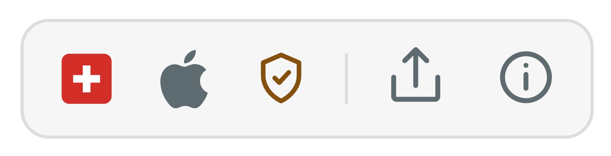
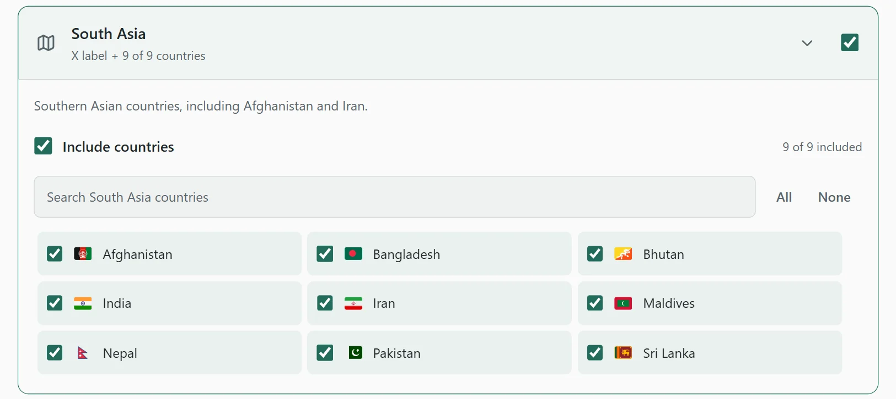
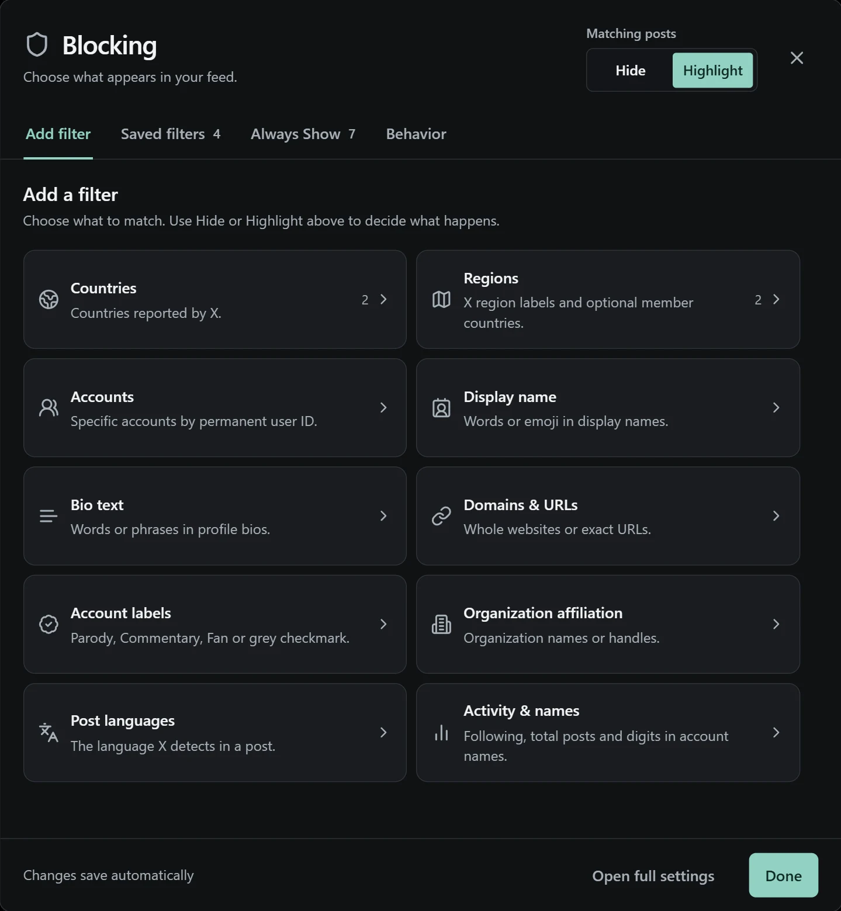
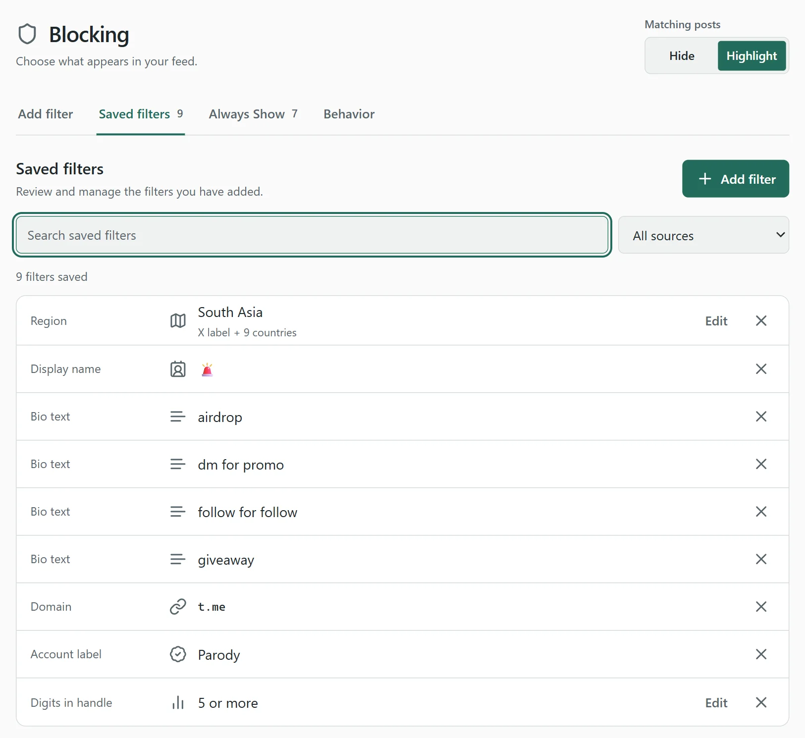
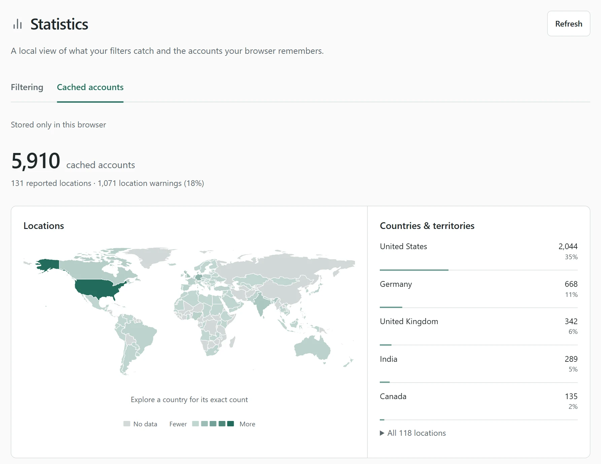
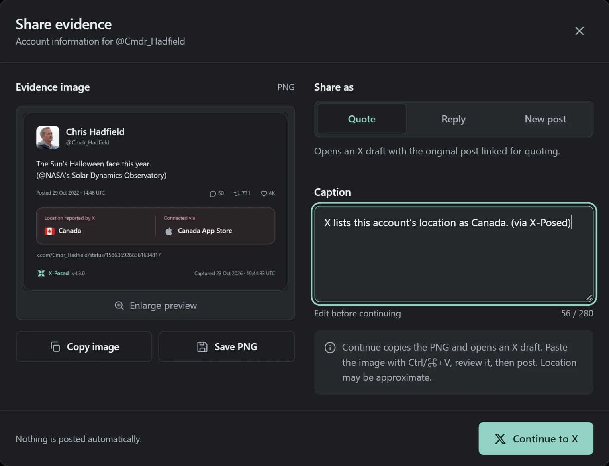

# X-Posed: Europe + US fork

Personal fork of [Alexander Hagenah's X-Posed](https://github.com/xaitax/x-account-location-device), based on version 4.4.0. The upstream documentation and credits are preserved below. Store links below install the upstream extension, not this fork.

## What this fork adds

- **Manage filters > Locations > Only keep Europe and the United States** filters accounts based elsewhere. Choose Hide or Highlight. The mode is optional and off until enabled.
- Uses **Account based in**, independently of the app-store country used for flags.
- Unknown locations remain visible unless **Also filter unknown locations** is enabled. Pending requests and failures stay visible. A broad region containing both allowed and excluded countries, such as North America, counts as unknown.
- Keeps the upstream Europe country/territory grouping and adds Cyprus. Accepts the Europe, European Union and Eastern Europe (Non-EU) labels. Russia is included; Turkey and the Caucasus are excluded. The complete included list is available in Locations.
- Works with existing Always Show exceptions, Hide/Highlight, quote controls, live updates, saved profiles and backups. Other saved rules can still filter allowed locations.
- Community Cache is **opt-in on new installs**. Enabling it shares public handles and account metadata with the upstream cache service as described in [PRIVACY.md](PRIVACY.md). Existing preferences are preserved on updates.

## Install this fork in Chrome

1. With Node.js 20 or newer, in `extension/`, run `npm ci`, `npm run build`, and `npm run check:build`.
2. Open `chrome://extensions`, enable **Developer mode**, and choose **Load unpacked**.
3. Select this checkout's `extension/dist/chrome` directory.
4. Refresh **every already-open X tab** once. Switching pages inside X does not activate the extension in an old tab. The **Blocking** link in X's sidebar confirms that the extension is running there.
5. Open **Blocking > Locations** and enable the mode. Hide is the default action.

This fork has a distinct extension name and Firefox ID. Avoid enabling the upstream extension and this fork on X at the same time because both modify timeline posts. It is not published to a browser store.

Run `npm run check:locations` for the location-filter checks. The build also produces `extension/dist/firefox` for temporary loading through `about:debugging`.

For a browser smoke test, run `npx playwright install chromium` once, then `npm run check:browser` after building. It loads the actual Chrome extension into an isolated profile with a synthetic timeline and local account observations. All HTTP traffic is fulfilled locally or aborted; it does not access a real X account. Screenshots are written under `extension/.tmp/browser/`.

---

<p align="center">
  
</p>

<h1 align="center">X-Posed</h1>

<p align="center">
  <strong>Context for every account on X.</strong><br>
  See where X says an account is based, how it connects and when X isn't sure, right next to its name.<br>
  Open a badge for the full account card, or hide whole countries and regions from your feed.
</p>

<p align="center">
  <a href="https://chromewebstore.google.com/detail/x-posed-account-location/oodhljjldjdhcdopjpmfgbaoibpancfk"></a>
  <a href="https://chromewebstore.google.com/detail/x-posed-account-location/oodhljjldjdhcdopjpmfgbaoibpancfk"></a>
  <a href="https://chromewebstore.google.com/detail/x-posed-account-location/oodhljjldjdhcdopjpmfgbaoibpancfk"></a>
  <a href="https://chromewebstore.google.com/detail/x-posed-account-location/oodhljjldjdhcdopjpmfgbaoibpancfk"></a>
  <a href="https://chromewebstore.google.com/detail/x-posed-account-location/oodhljjldjdhcdopjpmfgbaoibpancfk"></a>
  <a href="https://addons.mozilla.org/en-GB/firefox/addon/x-posed-account-location-devic/"></a>
  <a href="https://addons.mozilla.org/en-GB/firefox/addon/x-posed-account-location-devic/"></a>
</p>

<p align="center">
  <a href="CHANGELOG.md">Version 4.4</a> ·
  <a href="#install">Install</a> ·
  <a href="#what-the-badge-shows">Badges</a> ·
  <a href="#account-cards">Account cards</a> ·
  <a href="#filters">Filters</a> ·
  <a href="PRIVACY.md">Privacy</a> ·
  <a href="#support">Support</a>
</p>


*Account context and quick filters in action. Screenshot from X-Posed 4.3.*

X-Posed is a free, open-source browser extension. It brings the information from X's **About this account** page into your timeline, with filters, local statistics and sharing tools. There is no account to create, no tracking and no ads.

**It shows what X reports, not a person's live location or the device used for a particular post.** Missing data stays unknown, and a location warning is not proof of VPN use.

## Install

| Browser | Get it | Needs |
| --- | --- | --- |
| Chrome, Edge, Brave, Opera, Vivaldi and other Chromium browsers | [Chrome Web Store](https://chromewebstore.google.com/detail/x-posed-account-location/oodhljjldjdhcdopjpmfgbaoibpancfk) | Version 111 or newer |
| Firefox, and Firefox-based browsers such as Zen and LibreWolf | [Firefox Add-ons](https://addons.mozilla.org/en-GB/firefox/addon/x-posed-account-location-devic/) | Firefox 140 or newer |
| Firefox for Android | [Firefox Add-ons](https://addons.mozilla.org/en-GB/firefox/addon/x-posed-account-location-devic/) | Firefox for Android 142 or newer |

Install it, reload X and browse while signed in. Badges appear as you scroll. To set up your feed, choose **Manage filters** in the extension popup.

This README describes source version 4.4.0; store updates roll out separately. To run your own build, see [Build from source](#build-from-source).

**iPhone and iPad:** the separate [X-Posed Location](https://apps.apple.com/us/app/x-posed-location/id6755918713) app looks up usernames. It isn't the browser extension and doesn't change your timeline.

## What the badge shows

<p align="center">
  <picture>
    <source media="(prefers-color-scheme: dark)" srcset="screenshots/v4.3/badge-dark.webp">
    
  </picture>
</p>

| Part | What it means |
| --- | --- |
| Flag | The country or region X reports: 250+ countries and territories, plus 16 regional labels such as Europe or South Asia |
| Apple, Android or globe | The account connects through the App Store, Google Play or the web |
| Amber shield | X marks the location as possibly inaccurate |
| Share | Turns the post into an image with its context |
| Info | Opens the account card |

Badges appear wherever names do: in your timeline, replies and quoted posts, on profiles, and in lists like Followers and Following. They follow X's light or dark theme, come in three sizes, and can drop their background for icons only. Preview your choice in **Settings → Display**.

They also appear in identifiable one-to-one **Chat** headers, inbox rows and message requests. Open the badge for the same account card. If X hasn't provided a reliable account identity, the sender stays unmarked.

## Account cards

Hover, click or tap a badge to see what X's **About this account** page knows, without leaving your feed:

- **Location and connection**: the country or region X reports, and whether the account uses an app store or the web.
- **Activity**: followers, following, posts and media, from the profile data X already loaded.
- **Account history**: when it was created and verified, and how often the handle changed.
- **Verification and affiliation**: blue, gold or grey checkmarks, and the organization an account belongs to.
- **A link that lasts**: copy an ID-based profile link that keeps working after handle changes.
- **One-click actions**: filter the account or its country, keep it visible with **Always Show**, or copy and save the card as an image.

## Filters

Choose what to match, then **Hide** matching posts or **Highlight** them with an amber edge. Filters only change what you see. Nobody is blocked, muted or notified on X. Changes apply at once, including to posts already on the page.

Open the editor from **Manage filters** in the popup, **Settings → Blocking**, or the **Blocking** link X-Posed can add to X's sidebar.

### Keep different filter profiles

Save named setups for work, personal browsing or anything else. Create, rename or delete them in **Settings → Blocking**. Switch there or under **More controls → Filtering preferences → Filter profile** in the popup; open controls stay in sync.

Each X account remembers its choice, and any account can use any saved profile. Changes save to the selected profile. Your existing filters become **Default**; appearance preferences and the account cache stay shared.

### Block whole countries and regions

This is where most people start. Pick any of 250+ countries and territories, or one of the 16 regions X reports, such as South Asia or Africa. A region filter matches X's label, and you decide whether it also covers all, some or none of the countries inside it.

Turn on **Use device country** to go by the app store an account connects through, not only the location it shows. X's location warnings can count as a match too.

<p align="center">
  <picture>
    <source media="(prefers-color-scheme: dark)" srcset="screenshots/v4.3/region-countries.webp">
    
  </picture>
</p>

### What you can match

| Filter | Matches |
| --- | --- |
| Countries and X regions | The account's reported country or regional label, or the connection's country if you choose |
| Accounts | Specific accounts by permanent user ID, so handle changes don't matter |
| Display name and bio text | Words or phrases, case-insensitive; display-name rules also take emoji |
| Domains and URLs | Profile websites and bio links: a whole domain, including subdomains, or one exact URL |
| Account labels | Parody, Commentary, Fan, or the account's grey government or multilateral checkmark |
| Organization affiliation | An organization name or handle |
| Post language | The language X assigns to the post text |
| Activity & names | Minimum Following or Total posts, plus digits in handles and display names |
| Location warnings | Accounts whose location X marks as possibly inaccurate |

**Always Show** keeps the accounts you choose visible, and an option exempts everyone you follow.

### Recipes

| Goal | Rules |
| --- | --- |
| A whole region | Region: South Asia, with all 9 countries |
| Crypto spam | Bio: `airdrop`, `giveaway` · Domain: `t.me` |
| Engagement bait | Display name: 🚨 · Bio: `follow for follow` · Following: 5,000 or more |
| Throwaway accounts | Handle digits: 5 or more, in Highlight mode |
| Friends stay visible | Always Show: accounts I follow |

<details>
<summary><strong>How matching works</strong></summary>

<br>

A match on any applicable rule is enough.

- **Regions can include countries.** Expand a region under **Add filter → Regions** to browse its flags. Choose individual countries, or enable **Include countries** to select them all; either action automatically enables the region. Customize the list with individual checkboxes or **All / None**. Existing filters stay label-only until you opt in. Regions can overlap, so excluding a country in one does not override another matching filter. Membership follows [UN M49 geography](https://unstats.un.org/unsd/methodology/m49/) with documented composite groups, not a claim about X's boundaries. Antarctica remains country-only.
- **Choose the location source.** Enable **Behavior → Use device country when available** to use a country from the connection-source label, falling back to the account location. This affects both flags and country/region filters.
- **Always Show takes priority.** Exempt accounts from its tab or their account card. Your own recognized account is exempt too. New installs include `@xaitax` in Always Show; removing it is respected.
- **Accounts you follow can be exempt too.** Enable **Always Show → Always show accounts I follow**, off by default. It applies as X loads follow status; already-loaded accounts may need a refresh or further browsing. Confirmed followed accounts bypass filters, while unknown status uses normal filtering. No extra requests are made, and **Use profile details** can remain off. Follow status stays in page-session memory, is cleared when the signed-in account changes, and is never uploaded or backed up. Only the preference is included in backups. Quoted authors are checked independently.
- **Quotes keep their own rules by default.** A matching quoted account can collapse independently, with a **Show quoted post** control and the matching reasons. Language and location-warning filters apply to the enclosing post, not independently to its quoted author.
- **Hide related posts, optionally.** Enable **Behavior → Hide replies and quotes of filtered posts** to collapse whole replies and quotes, even when their source is only highlighted. Each gets a reason and **Show post** control. This uses relationships X already loads, without extra requests. Unknown sources keep normal filtering, and existing exceptions still apply. Authors are not added to your filters.
- **Opened posts respect explicit account filters.** Broad filters highlight a deliberately opened main post rather than hiding it, but a direct account filter still hides it in Hide mode. Replies retain their normal rules. Posts you explicitly reveal stay readable, and matching accounts in people lists are highlighted, never removed.
- **Missing information is not guessed.** Language filtering uses X's displayed-text language marker; auto-translation can make the original language unavailable. Unknown languages are not filtered, and government status requires the account's own grey checkmark.

**Domains and exact URLs.** Under **Add filter → Domains & URLs**, `example.com` matches that site and its subdomains. `example.com/channel` becomes an exact rule for `https://example.com/channel`, not the whole site. An explicit HTTP(S) URL, query or fragment also creates an exact rule. Exact rules preserve the hostname, scheme, path case, trailing slash, query and fragment after standard URL parsing. They do not include child pages. Redirects and short links are not followed; unavailable destinations stay unknown. Bio-text and link filters each have a default-off option to also check self-written **profile location text**, which is separate from X's account-country label.

**Activity & names.** Following and Total posts use counts X already loads, with presets and custom minimums; **5,000 or more** includes exactly 5,000, and unknown counts do not match. Following means accounts followed, not followers. **Handle digits** counts all digits in the actual `@handle` (suggested minimum 5, adjustable from 1 to 15): `@alex1990` has four digits, `@a1b2c3d4e5` has five. **Display-name digits** is a separate rule (suggested 5, adjustable from 1 to 50) that counts decimal digits, including styled and non-Latin digits. Digits in a name and handle are never added together. Turning off **Behavior → Use profile details** leaves the two activity rules saved but inactive; the digit rules keep working.

**Location warnings and keyboard shortcut.** Enable **Behavior → Filter accounts with location warnings** to include them in Hide/Highlight. A warning indicates uncertainty, not confirmed VPN use. You can assign **Switch matching posts between Hide and Highlight** in your browser's extension-shortcut settings; no shortcut is assigned by default.

</details>

## Statistics and sharing

**Statistics** count each post your filters catch once, whether hidden or highlighted, and map them by country, region and device. A second view maps the accounts your browser has cached. Everything is worked out locally from data already in your browser, and nothing is uploaded.

**Share** turns a post into a polished card with its text, photos and account context: the location X reports, the connection, any location warning, the link and the capture time. Review the preview and caption, then choose Quote, Reply or New post, or save the card. Nothing is posted for you.

<details>
<summary><strong>Statistics and data controls</strong></summary>

<br>

**Statistics → Filtering** counts identifiable matching posts once across tabs and browser restarts. Counting starts as you browse, with no history backfill. Quotes need their own reliable post ID; a quote removed with its hidden parent is not counted separately. These are cumulative totals, not a live timeline count or per-rule counters. **Cached accounts** is a separate view of your browser's account cache, not the community cache. Small countries missing from the map remain in the lists.

| Control | What it does |
| --- | --- |
| Statistics → Filtering → Reset counts | Removes filtering totals and deduplication fingerprints, without changing filters or cached accounts |
| Data & Cache → Clear Cache | Clears locally cached account details, not community records or filtering statistics |
| Data & Cache → Export Data | Backs up every profile and its filters, saved account selections, settings, Always Show accounts, theme, community-cache preference and local cached accounts, but not X headers or statistics |
| Data & Cache → Import Data | Restores the complete profile collection from a full backup. Older backups update only supplied fields in the selected profile. Outdated or invalid cached accounts are skipped without replacing newer observations |

The local account cache holds up to 50,000 accounts for up to 60 days. Downloading a shared record preserves its remaining lifetime rather than making it fresh again. Treat exported files as private.

The share image includes the post's available text, up to four attached photos without cropping, metrics and account information, plus separate post and capture times, original URL and extension version. It is not a full thread or video archive. Desktop browsers copy the image and open X's composer; paste the image if needed. Supported mobile browsers can use their share sheet.

</details>

## Screenshots

Real screenshots of X-Posed 4.3. Filter screens use example settings.

<table>
  <tr>
    <td width="50%" valign="top"><br><strong>The filter editor, right on X</strong><br>Ten filter types, one Hide or Highlight switch.</td>
    <td width="50%" valign="top"><picture><source media="(prefers-color-scheme: dark)" srcset="screenshots/v4.3/saved-filters.webp"></picture><br><strong>Saved filters</strong><br>Search, edit and remove your rules.</td>
  </tr>
  <tr>
    <td valign="top"><picture><source media="(prefers-color-scheme: dark)" srcset="screenshots/v4.3/statistics.webp"></picture><br><strong>Statistics</strong><br>Local counts and maps, without extra lookups.</td>
    <td valign="top"><br><strong>Share</strong><br>Preview the image and caption, then post it yourself.</td>
  </tr>
</table>

## Privacy and accuracy

- No X-Posed account, usage analytics or advertising. Filtering statistics remain in your browser.
- The extension uses your existing X session. Captured authorization and CSRF headers are stored locally and sent only to X, never to the community cache.
- In this fork, the community cache is **disabled on new installs** and can be enabled under **Settings > Cloud Cache**. It shares public handles and account metadata, not post text, biographies, private messages or session headers. These records are identifiable, not anonymous.
- Profile text, links, labels and counts read from X's existing timeline responses stay in page-session memory. Turn this off under **Blocking → Behavior → Use profile details**.
- X's labels and shared cache records can be incomplete, stale or incorrect. Check important findings against X. Rate-limit handling cannot guarantee protection from X's account enforcement.

Read the [privacy policy](PRIVACY.md) for data flows, permissions and retention. X-Posed is independent and is not affiliated with or endorsed by X Corp.

## Support

X-Posed is free and open source. **A huge thank you to everyone who has donated.** Your support helps cover development and the community cache. There is no need to donate, but it helps tremendously.

**[Buy me a coffee on Ko-fi](https://ko-fi.com/M4M61EP5XL)** or donate **BTC, ETH or USDC**. Copy the addresses in **Settings → About** or below.

**Bitcoin (BTC) · Network: Bitcoin**

```text
35r5XS95AuvNcLqw13ULwH8XifQD9WxddX
```

**Ethereum (ETH) and USD Coin (USDC) · Network: Ethereum / ERC-20**

```text
0xDeB8e90373C121EcCB9693f8Ff2D4f39ea55f5c0
```

Check the network before sending. Send BTC on Bitcoin, and ETH or USDC on Ethereum only. ETH and USDC intentionally share the same receiving address.

## Build from source

Use Node.js 20 or newer and npm for this fork.

```bash
git clone https://github.com/xaitax/x-account-location-device.git
cd x-account-location-device/extension
npm ci
npm run lint
npm run build
npm run check:build
```

- **Chrome:** open `chrome://extensions`, enable Developer mode, select **Load unpacked**, and choose `extension/dist/chrome`.
- **Firefox:** open `about:debugging`, choose **This Firefox → Load Temporary Add-on**, and select `extension/dist/firefox/manifest.json`. This development installation is temporary.

Reload the extension and refresh open X tabs after rebuilding. Use `npm run dev:chrome` or `npm run dev:firefox` for watch mode, and `npm run package` to create both store-upload ZIPs in `extension/dist/`.

The browser extension lives in `extension/src/`, grouped into content scripts, background services, shared modules, settings, popup and styles. The older `userscript/` is not feature-equivalent to the extension.

## Contribute

[Report a bug or suggest a feature](https://github.com/xaitax/x-account-location-device/issues). Include browser and extension versions and steps to reproduce. Never include cookies, authentication headers, private account data or unredacted network logs.

For code contributions, keep changes focused, preserve existing preferences and reuse the shared filtering and settings modules. Run the checks above and verify Chrome and Firefox. UI changes should cover light and dark themes; filter changes should cover Hide and Highlight, Always Show, quoted and opened posts, and cross-tab settings updates.

Thank you to everyone who contributes code, reports bugs, shares ideas, tests releases or supports development. Release-specific credits are in the [changelog](CHANGELOG.md).

Built by [Alexander Hagenah](https://primepage.de) · [@xaitax](https://x.com/xaitax) · [MIT License](https://spdx.org/licenses/MIT.html)
